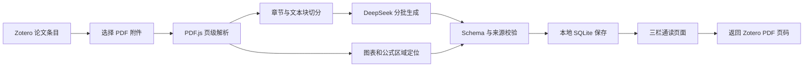

#  Paper Reader

基于 Zotero 10 的医学影像英文论文智能通读插件。

> 当前版本：`0.2.1`。这是面向个人使用的本机 MVP，不用于临床诊断、医学决策或大规模生产部署。

[项目概览](#项目概览) · [快速开始](#快速开始) · [使用说明](#使用说明) · [开发与验证](#开发与验证) · [目录结构](#目录结构) · [项目文档](#项目文档) · [当前边界](#当前边界)

## 项目概览

插件从 Zotero 当前条目的 PDF 中读取全文，生成保留原文、中文辅助、术语解释、方法梳理、关键结果、批判性阅读、小测和论文逻辑线路的三栏通读页面。所有摘录、实验数字、图表和逻辑节点都保留原文页码入口，方便随时返回 Zotero PDF 核对。

### 主要功能

- 保留可提取文本 PDF 的全文内容，不只生成摘要。
- 根据章节和段落分批生成中文阅读辅助。
- 公式区域以原论文截图呈现，不翻译数学论证。
- 自动保留 Figure、Table 和公式区域，增加图文结合的阅读体验。
- 左侧章节导航可直接跳转并高亮当前位置。
- 原文段落、关键数字、图表和逻辑节点可返回对应 PDF 页码。
- 文末生成论文逻辑线路，串联研究问题、方法、实验、结论和局限。
- 支持译文显隐、字号调整、阅读小测和本地阅读进度。
- 同一篇论文只需生成一次，结果保存在本机，后续可直接打开。
- 生成失败时保存已完成批次，便于重试和问题排查。

### 工作流程



模型输出不能直接覆盖原始来源。保存前会检查文本块覆盖情况、来源 ID、关键数字和结构化数据；缺失、重复或未知的原文块会阻止结果被标记为完整。

### 技术组成

- TypeScript：插件业务逻辑和数据模型。
- Zotero Bootstrap Plugin：插件生命周期、条目菜单和右侧面板。
- PDF.js：PDF 页级文本解析、坐标定位和可见窗口图像渲染。
- DeepSeek Responses API：分批生成结构化通读内容。
- JSON Schema + Ajv：约束模型输出结构。
- SQLite：保存生成结果和恢复状态。
- 原生 HTML/CSS：三栏通读界面，不依赖前端框架。
- esbuild：打包 Zotero 可加载的脚本。

## 快速开始

### 系统要求

- macOS
- Zotero `10.0.x`
- Node.js 22 或更高版本（仅自行构建时需要）
- `zip` 命令（仅自行构建 XPI 时需要，macOS 通常已提供）
- 可提取文本的英文论文 PDF
- 可用的 DeepSeek API Key

目前使用 macOS 钥匙串保存密钥，因此 Windows 和 Linux 尚未纳入本版本支持范围。

### 使用 XPI

1. 从可信构建获取 `paper-reading-assistant-0.2.1.xpi`；没有安装包时，按下方步骤从源码构建。
2. 打开 Zotero，进入“工具 → 插件”。
3. 点击插件管理器右上角的工具按钮。
4. 选择“Install Plugin From File…”并打开 XPI。
5. 确认插件医学影像论文智能通读助手已启用。

升级同一版本的开发包时，建议先在插件管理器中移除旧包，完全退出 Zotero，再安装新的 XPI。通读数据库独立存放，正常卸载插件不会删除已生成结果。

当前未配置自动更新服务，请手动安装新的 XPI。

### 从源码构建

```bash
git clone https://github.com/QTSHI/Paper-Reader.git
cd Paper-Reader
npm ci
npm run build
```

`npm ci` 按 `package-lock.json` 安装依赖。`npm run build` 会先清理 `build/`、`dist/`，再运行类型检查、自动测试并打包。

构建完成后，安装包位于：

```text
dist/paper-reading-assistant-0.2.1.xpi
```

### 配置 DeepSeek API Key

API Key 不写入源码、Zotero 偏好或通读数据库。请在 macOS“终端”中执行下面的命令，并在系统提示时输入密钥：

```bash
security add-generic-password \
  -U \
  -a "paper-reading-assistant@local" \
  -s "com.openai.paper-reading-assistant.deepseek-api-key" \
  -w
```

`-w` 位于命令末尾时，系统会安全地提示输入密码，避免将密钥直接留在终端历史中。

当前代码使用以下模型配置：

```text
Provider: DeepSeek
Endpoint: https://api.deepseek.com/responses
Model: deepseek-v4-flash
```

接口和模型目前固定在 `src/generation/deepseek.ts` 中，尚未提供插件内设置页面；修改 `addon/prefs.js` 中的同名偏好不会切换实际调用的接口或模型。

请确认自己的 DeepSeek 账户可以使用该接口和模型。模型调用可能产生费用，论文文本会按批次发送给模型服务。敏感、未公开或受限制的论文不应直接发送到第三方模型；后续版本计划提供本地模型适配。

## 使用说明

1. 在 Zotero 中选择一个论文条目，或直接选择其 PDF 附件。
2. 在右侧“智能通读”区域点击“生成全文通读”，也可以使用条目右键菜单。
3. 如果条目有多个 PDF，选择本次需要处理的附件。
4. 等待 PDF 解析、分批生成和来源校验完成。
5. 点击“打开通读”进入三栏阅读页面。

已经生成过的论文会直接打开本地结果。只有点击“重新生成全文通读”才会覆盖旧结果并再次调用模型。

### 本地数据与隐私

通读结果保存在 Zotero 当前配置目录下的独立数据库：

```text
paper-reading-assistant.sqlite
```

数据库保存论文元数据、PDF 哈希、原文定位、生成内容、图表缓存和阅读状态，不写回 Zotero 文献条目。记录以文库 ID、条目 Key 和附件 Key 关联，并保存附件版本与 PDF 哈希，用来识别来源是否变化。

API Key 只从 macOS 登录钥匙串读取。项目源码、XPI 和 SQLite 均不应包含 API Key。

## 开发与验证

```bash
npm run typecheck
npm test
npm run build
npm audit --omit=dev
```

常规自动测试不调用模型服务，也不需要 API Key。真实 PDF 提取测试默认跳过；如需运行，请提供本机可读的测试文件路径：

```bash
PAPER_READER_TEST_PDF="/absolute/path/to/sample.pdf" npm test
```

真实 PDF 测试只验证文本提取和来源结构，不调用 DeepSeek。`scripts/smoke-deepseek.ts` 是单独的真实接口实验，会发送论文内容并可能产生费用，不在 `npm test` 或常规 CI 中运行。

`mock` provider 仅用于局部内容预览，不能代替完整论文的生成验收。开发流程、测试边界和问题反馈方式见 [CONTRIBUTING.md](CONTRIBUTING.md)。

### 历史实测记录

项目现有的 `0.2.1` 实测记录来自 Zotero 10.0.1 和一篇 10 页医学影像论文 STADNet：

- 161/161 个原文文本块进入通读结果。
- 139 个文本块生成中文辅助。
- 识别并缓存 29 个图表或公式区域。
- 生成 11 个逻辑节点、14 条逻辑连线和 5 道小测。
- 左侧章节导航、返回 PDF 原文、图片渲染和本地重复打开均可用。

以上结果只代表当前样本文档，不等同于对所有 PDF 版式的准确率承诺。

## 目录结构

```text
addon/                  Zotero 清单、启动入口和本地化资源
src/domain/             数据类型与 JSON Schema
src/source/             PDF 解析、章节切分、图表和公式定位
src/generation/         DeepSeek、OpenAI 和 Mock 适配器
src/validation/         来源、数字和结构校验
src/storage/            SQLite 存储
src/integration/        Zotero 条目与附件集成
src/ui/                 三栏阅读页面
tests/                  自动测试与真实 PDF 烟雾测试
scripts/                构建和接口检查脚本
```

## 项目文档

| 文档 | 内容 |
| --- | --- |
| [贡献指南](CONTRIBUTING.md) | 开发、验证、问题反馈与生成文件约定 |
| [项目建议书](基于Zotero的医学影像英文论文智能精读插件项目建议书.md) | 原始项目背景、目标与设计方案 |
| [0.2 优化建议书](医学影像论文智能通读助手_0.2优化建议书.md) | 自查结果与后续优化计划 |

## 当前边界

- 不支持扫描版 PDF OCR。
- 双栏正文、参考文献和正文混排时，少量文本块可能出现阅读顺序问题。
- 图表与公式定位目前依赖图注、文本特征和启发式裁切，跨页图表及特殊版式仍需人工核对。
- 当前只完成一篇医学影像论文的完整实机验收，尚未达到通用准确率结论。
- 尚未提供插件内设置页面、任务队列、多论文批处理和可视化错误修复工具。
- 不支持多用户、云端同步、协作或长期学习画像。
- 模型输出可能出错；涉及实验数字、方法结论和临床声明时必须返回原论文复核。

### 后续方向

- 增加插件内模型、阅读等级和辅助强度设置。
- 引入版面感知解析，提高双栏、图表和公式识别准确率。
- 增加图表正文引用关系和图片缩放查看。
- 提供断点续传、失败批次重跑和生成成本预估。
- 支持导出独立 HTML、Markdown 和学习笔记。
- 在完成多篇论文验收后，再评估 Zotero 11 和其他操作系统支持。
